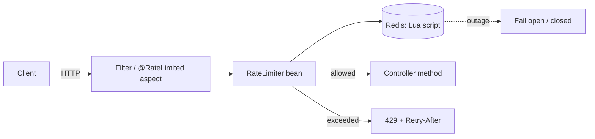

# rate-limiter-spring-boot-starter

A Spring Boot starter that provides **distributed, atomic rate limiting** (token bucket) backed by Redis. Works across multiple application replicas because all state lives in Redis, and check-and-decrement is a single atomic Lua script.

## Why

A single-instance in-memory limiter breaks when the service runs on multiple replicas: each replica has its own counter, so the effective limit is `limit × replicas`. This starter moves the counter to Redis and enforces it atomically, so the limit holds regardless of how many replicas run.

## Features

- Token bucket algorithm with configurable capacity and refill rate.
- Limit by user ID, API key, or IP address (or a custom `KeyResolver`).
- `@RateLimited(capacity = ..., refillPerSecond = ...)` on controller methods.
- Servlet filter configurable via `application.yml` (path patterns).
- `429 Too Many Requests` with `Retry-After` and `X-RateLimit-*` headers.
- Auto-configuration: adding the dependency is enough to enable it.
- Fail open (default) or fail closed on Redis outage, with a timeout (default 100 ms).

## Quick start

Add the dependency (available via local `~/.m2` after `mvn install`):

```xml
<dependency>
    <groupId>com.iqbalmz</groupId>
    <artifactId>rate-limiter-spring-boot-starter</artifactId>
    <version>0.0.1-SNAPSHOT</version>
</dependency>
```

For GitHub Packages, add the repository and a `<server>` entry with a token to `~/.m2/settings.xml`.

### Annotation usage

```java
@RestController
public class OrderController {

    @RateLimited(capacity = 10, refillPerSecond = 1)
    @GetMapping("/orders")
    public List<Order> list() { ... }
}
```

### Filter usage (application.yml)

```yaml
rate-limiter:
  filter:
    enabled: true
    paths:
      - /api/**
    capacity: 100
    refill-per-second: 10
```

## Run (local development)

```bash
# 1. Start Redis
docker run -d --name rl-redis -p 6379:6379 redis:7-alpine

# 2. Build and test
mvn -B verify          # requires Docker for Testcontainers

# 3. Install to local ~/.m2 for use by other projects
mvn -B install -DskipTests
```

## Configuration properties

| Property | Type | Default | Description |
|----------|------|---------|-------------|
| `rate-limiter.enabled` | boolean | `true` | Master switch (opt-out). |
| `rate-limiter.fail-mode` | `OPEN`/`CLOSED` | `OPEN` | Behavior on Redis outage. |
| `rate-limiter.timeout` | Duration | `100ms` | Max wait for Redis. |
| `rate-limiter.default-capacity` | long | `100` | Default bucket capacity. |
| `rate-limiter.default-refill-per-second` | double | `10` | Default refill rate. |
| `rate-limiter.key-resolver` | `IP`/`USER`/`API_KEY`/`COMPOSITE` | `IP` | How the bucket key is derived. |
| `rate-limiter.filter.enabled` | boolean | `false` | Enable servlet filter. |
| `rate-limiter.filter.paths` | List<String> | `[]` | Path patterns the filter applies to. |
| `rate-limiter.filter.capacity` | Long | (default) | Override capacity for the filter. |
| `rate-limiter.filter.refill-per-second` | Double | (default) | Override refill rate for the filter. |

## Architecture



All state lives in Redis. The library beans are stateless singletons, so the app tier scales horizontally.

## Algorithm comparison

| Algorithm | Memory | Accuracy | Burst handling | Notes |
|-----------|--------|----------|----------------|-------|
| Fixed window | O(1) | Low (boundary burst) | Poor | Simplest; 2x limit possible at window edge. |
| Sliding window log | O(requests) | Exact | Good | Expensive at high traffic. |
| Sliding window counter | O(1) | Approximate | Good | Cloudflare-style weighted blend. |
| **Token bucket (chosen)** | **O(1)** | **Good** | **Explicit burst size** | Industry default; maps to one atomic Lua script. |

**Why token bucket:** explicit burst sizing matches real traffic (a page load fires many requests at once), O(1) memory per key, and check-and-decrement is a single atomic Redis operation.

## Trade-offs

- **Fail open by default:** preserves availability during a Redis outage; abuse is unbounded only for the outage duration. Operators needing strictness set `fail-mode: CLOSED`.
- **Servlet-only (v1):** reactive/WebFlux is deferred to v2; the core `RateLimiter` bean is stack-agnostic and reusable.
- **Optional dependencies:** Redis and validation are `optional=true`; consumers opt in. AOP is a hard dependency because `@RateLimited` needs it.
- **No Micrometer metrics yet** (known issue): rejection counts and latency are logged but not exposed as metrics.

## Redis outage behavior

- Default **fail open**: if Redis is unreachable, requests are allowed and a WARN is logged.
- Set `rate-limiter.fail-mode: CLOSED` to reject all traffic on outage (stricter, but turns a Redis blip into a full API outage).
- All Redis calls are bounded by `rate-limiter.timeout` (default 100 ms); the host request never hangs.

## Test

```bash
mvn -B verify   # requires Docker for Testcontainers
mvn -B -Dtest=AutoConfigTest test
mvn -B -Dtest=RateLimiterConcurrencyTest test
mvn -B -Dtest=MultiInstanceRateLimitTest test
```

Tests:
- `AutoConfigTest` — auto-configuration activation, opt-out, bean registration.
- `RateLimiterConcurrencyTest` — 200 threads, one key, allowed never exceeds capacity.
- `MultiInstanceRateLimitTest` — two instances share one Redis limit.
- `RedisOutageFailModeTest` — fail-open allows, fail-closed rejects on outage.

Clean output:
```bash
mvn -B verify -Dorg.slf4j.simpleLogger.log.org.testcontainers=warn 2>&1 \
  | grep -iE "Tests run:|BUILD (SUCCESS|FAILURE)"
```

## Benchmarks

Benchmark numbers are reported only when measured. Not yet run — to be added with `/bench` (k6).

## Known limitations

- `X-Forwarded-For` is trusted unconditionally (IP spoofing risk) — see known issues.
- Non-web `@RateLimited` invocations share a single fallback bucket.
- Micrometer metrics are not yet exposed.
- WebFlux is not supported in v1.

## License

Apache License 2.0.
